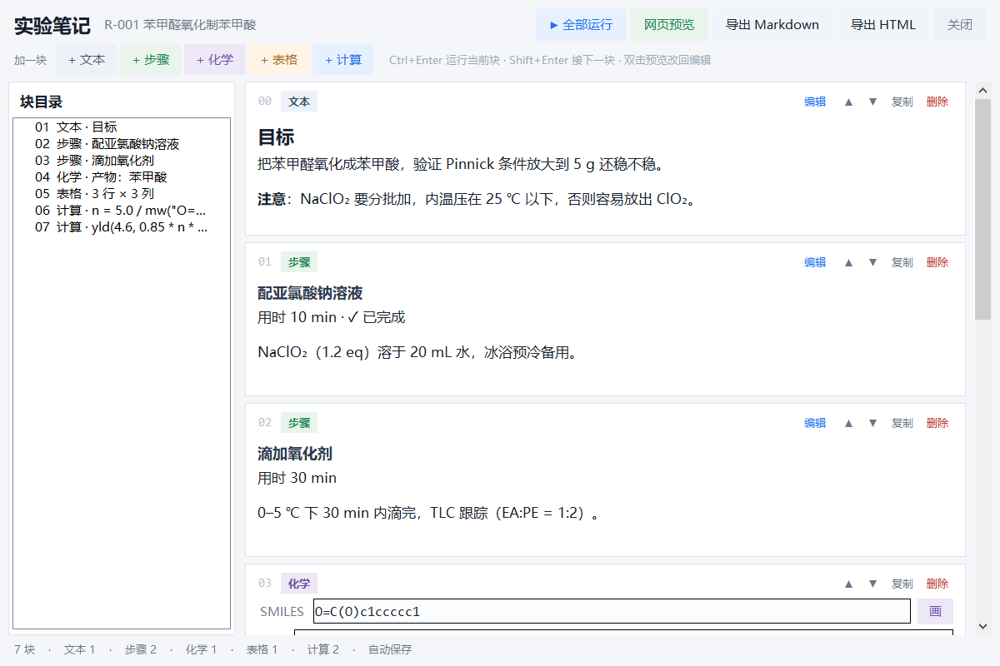
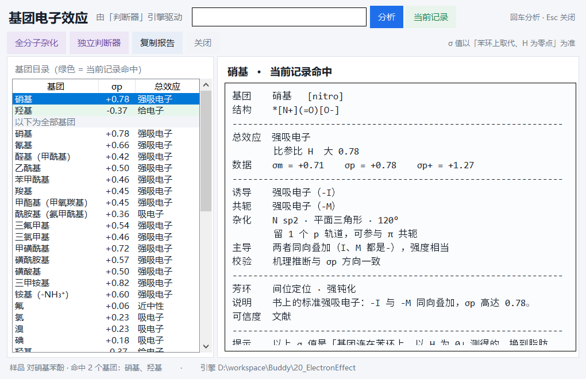

# ELN · 单机电子实验记录本

[](LICENSE)


一个**完全离线、双击即用**的化学实验记录本。数据就是一个 SQLite 文件加一个附件目录，
拷走就能带走全部记录；不需要装数据库、不需要服务器、不需要联网。

结构式可以用内置画板画，也可以交给**随包内置的 Ketcher 编辑器**（3.18，EPAM 开源，
手感接近 ChemDraw）精细编辑后回写——两者都能离线跑。

取的是 [Chemotion ELN](https://www.chemotion.net/) 的核心模型（集合 / 药剂 / 反应 / 组成 /
结构 / 附件 / 子结构检索），但把 Rails + PostgreSQL + Docker 那一整套服务端全砍掉了。


## 声明

**本项目的全部代码由 DeepSeek-V4.1-Flash 构建**（含本 README、手册与全部脚本）。

- 生成结果经过自动化自检（`python selfcheck.py`，490 项全绿）后发布；使用前建议再自行审阅关键逻辑。
- 代码按「现状」提供，不对适用于特定用途作任何担保；用于实验记录、数据处理前请自行评估与测试。
- 第三方组件的版权与许可归各自作者，详见 [THIRD-PARTY-NOTICES.md](THIRD-PARTY-NOTICES.md)。

## 能做什么

| 模块 | 说明 |
|---|---|
| **药剂台账** | 名称 / 编号 / CAS / SMILES / 分子量 / 纯度 / 状态 / 存放位置；填了 SMILES 实时出结构图与分子式 |
| **反应记录** | 条件、操作、产率；**组成表按当量双向换算**，改一行用量自动重算其它行 |
| **结构检索** | 文本、**子结构**（SMARTS）、相似性（Tanimoto）三种模式 |
| **内置画板** | 画结构式与反应式，存 JSON 可再编辑；导出 PNG，或交给 ChemDraw / Ketcher 编辑后读回 |
| **Ketcher 编辑器** | 内置 [Ketcher](https://github.com/epam/ketcher) 3.18（构建产物随包提供，**开箱可用**）；本机起一个临时端口打开，选完结构回写到记录 |
| **电子效应** | 选中取代基，按常见基团的 σ 值给出趋势判断 |
| **实验笔记** | 块式记录（文本 / 步骤 / 化学 / 表格 / 计算），可导出 Markdown / HTML |
| **导入导出** | SDF / CSV 进出；单条记录导出 PDF / DOCX；整库打包成 `.eln` 标准包 |
| **日历视图** | 按日期回看当天做了哪些实验 |
| **网页服务模式** | 可选：`python webapp.py --auth` 起局域网服务，多人用浏览器访问（见 [部署到服务器.md](部署到服务器.md)） |





## 获取与运行

### 方式一：免安装版（推荐）

下载 `ELN-<版本>-win64.zip`，解压后任选其一：

- **直接用**：双击 `ELN\ELN.exe`
- **装到本机**：双击 `安装.bat` —— 复制到 `%LOCALAPPDATA%\Programs\ELN`，
  并创建桌面与开始菜单快捷方式（不需要管理员权限）。卸载运行 `卸载.bat`。

首次启动会在程序目录自动建 `eln.db`（空库）和 `attachments/`。

### 方式二：源码运行

```bash
git clone https://github.com/mynaw/eln.git
cd eln
pip install -r requirements.txt      # 必需：rdkit pillow pywin32
python gui.py
```

Windows 上也可以直接双击 `Start.bat`（用 PATH 里的 `pythonw`，不弹控制台）。

**想看演示数据**（4 个药剂 / 1 个反应 / 2 张图，不含任何真实实验记录）：

```bash
python tools/load_demo.py     # 复制 demo/eln_demo.db → eln.db（已存在则跳过）
```

## Ketcher 编辑器

Ketcher 是前端工程，仓库里**已经带好构建产物**（`vendor/ketcher-app/dist/`，约 30 MB），
所以 clone 下来就能用，不需要装 Node.js。

- 在绘制区点「用 Ketcher 编辑」→ 程序在 `127.0.0.1` 上临时起一个 HTTP 服务打开编辑器
- 编辑完成点回写，结构以 MOL 文本回填到当前记录
- 全程本地，不访问外网

**只有在你想改编辑器本身时**才需要重新构建：

```bash
cd vendor/ketcher-app
npm ci          # 首次约 200 MB 依赖
npm run build   # 产物写回 dist/
```

或双击 `tools/build_ketcher.bat`。构建失败不影响 ELN 其它功能，只是「用 Ketcher 编辑」用不了，
内置画板照常工作。

## 数据与隐私

- **完全离线**：不做任何后台请求。只有主动点「CAS 查结构」时才会访问
  NCI Cactus / PubChem 的公开接口，结果缓存在 `cas_cache.json`，可随时删除。
- **数据在哪**：程序目录下的 `eln.db`（SQLite 单文件）+ `attachments/`（附件副本）。
  整个文件夹拷走就是完整迁移，`备份.bat` 会打包成 zip。
- **密码**：账户密码用加盐哈希（PBKDF2-HMAC-SHA256）+ Windows DPAPI 存储，不上传任何地方。
- **账户登录**：本机可建多个账户，各自独立 `eln.db` 与附件目录，互不可见；
  登录页支持「记住我」30 天免登录，也能一键退出（清除会话）。
- **多人共用**：不建议直接共享同一个库（SQLite 单文件写入）。多设备请用 SDF/CSV 汇总，
  或启用网页服务模式（见 [部署到服务器.md](部署到服务器.md)）。

## 已知限制

- **Windows 优先**：界面用 Tkinter，macOS / Linux 上能跑但未做适配测试。
- **画板不画立体化学**：楔形键/虚线键画不出来。但结构**预览与导出**图会按 SMILES 的
  `@`/`@@` 正确画出楔形并标注 (R)/(S)/(E)/(Z)；需要精确编辑时用内置的 Ketcher。
- **不做智能推断**：缩写基团（OBz、TBS…）只作标注，不会展开成真实结构；
  箭头上下的试剂文字只作图注，不进反应 SMILES。
- **单机单人**：本地模式没有权限管理与审计追踪，不是合规级 ELN。
- 完整边界说明见 [`MANUAL.md`](MANUAL.md) 第十二章。

## 目录结构（主要部分）

```
eln/
├── gui.py                 主窗口：三栏布局、工具栏、列表与详情
├── dialogs.py             新建 / 编辑对话框（药剂、反应、组成）
├── drawpad.py             绘制区：画板 + RDKit 转换 + ChemDraw/Ketcher 交换
├── ketcherwin.py          Ketcher 编辑器窗口（本地 HTTP 服务 + MOL 回写）
├── notebook.py            块式实验笔记
├── store.py               SQLite 数据层（schema / 迁移 / 查询）
├── chem.py                RDKit 封装：解析、出图、性质计算
├── structure.py           子结构 / 相似性检索
├── recexport.py           记录导出 PDF / DOCX
├── webapp.py              可选：网页服务模式（多账户登录）
├── auth.py                账户与口令（PBKDF2 + DPAPI）
├── admin_reset/           忘记管理员密码时的重置工具
├── vendor/ketcher-app/    Ketcher 前端工程（dist/ 为已构建产物）
├── tools/                 备份、演示库、Ketcher 构建、打包脚本
├── demo/eln_demo.db       演示数据（不含真实记录）
├── 部署到服务器.md        把 Web 模式放到云服务器 / 局域网的步骤
└── MANUAL.md              完整用户手册（程序内按 F1 打开同一份）
```

## 开发与自检

```bash
python selfcheck.py       # 490 项自检，全绿输出「通过 N 项，失败 0 项」
```

自检覆盖数据层、检索、导出、绘制、笔记、鉴权、网页服务、打包等模块，改完代码跑一遍最省心。

## 许可证

本项目以 **MIT** 许可发布，见 [LICENSE](LICENSE)。

依赖的第三方组件（RDKit / Pillow / Tcl-Tk / Ketcher / fpdf2 等）各自遵循其原有许可，
义务与说明见 [THIRD-PARTY-NOTICES.md](THIRD-PARTY-NOTICES.md)。
